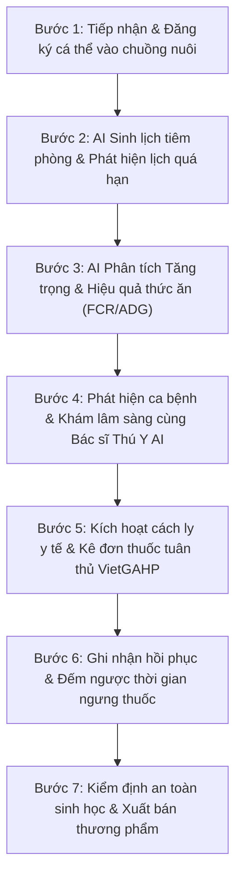

# KỊCH BẢN DEMO THỰC THẾ: QUY TRÌNH THEO DÕI MỘT ĐÀN VẬT NUÔI XUYÊN SUỐT
## DỰ ÁN: FARMPRO AI – HỆ THỐNG QUẢN LÝ CHĂN NUÔI CÓ TÍCH HỢP AI
* **Học phần:** Ứng dụng Trí tuệ Nhân tạo
* **Giảng viên hướng dẫn:** ThS. Nguyễn Đình Dũng
* **Lớp:** K23.K1.CNTT K23B
* **Mã chuẩn đầu ra:** CLO1, CLO2, CLO3, CLO4, CLO5 | PLO7

---

## 1. MỤC TIÊU VÀ ĐỐI TƯỢNG DEMO
* **Đối tượng theo dõi xuyên suốt:** Đàn Heo thịt thương phẩm giống Yorkshire (Đại diện cá thể: Thẻ tai **HEO-304**).
* **Mục tiêu:** Chứng minh toàn diện 5 nhiệm vụ của đề tài:
  1. Quản lý đầy đủ 4 mảng nghiệp vụ: Chăm sóc, Tiêm phòng, Tăng trưởng, Xuất bán.
  2. Phân quyền vai trò: Chủ trang trại (Quản lý), Kỹ sư chăn nuôi, Bác sĩ thú y.
  3. Ứng dụng AI thực tế: Sinh nhắc việc, tóm tắt tình trạng đàn, phân tích tăng trưởng FCR, chẩn đoán bệnh lâm sàng.
  4. Cơ chế rào chắn an toàn: Phát hiện lịch tiêm quá hạn, cảnh báo biến động thể trọng, từ chối xuất bán gia súc đang cách ly (VietGAHP).
  5. Tính nhất quán giữa giao diện Web React 19, API Node.js và hệ thống cơ sở dữ liệu.

---

## 2. LƯU ĐỒ 7 BƯỚC THEO DÕI XUYÊN SUỐT

---

## 3. CHI TIẾT THAO TÁC TỪNG BƯỚC TRÊN GIAO DIỆN

### BƯỚC 1: Tiếp nhận và đăng ký vật nuôi vào đàn
* **Tác nhân:** Kỹ sư chăn nuôi / Chủ trang trại.
* **Thao tác:**
  1. Vào menu **Đàn Vật Nuôi** (Tab `Animals`).
  2. Nhấp nút **+ Thêm Vật Nuôi**.
  3. Nhập các trường thông tin:
     - Mã thẻ tai: `HEO-304`
     - Tên gợi nhớ: `Heo Yorkshire Hậu Bị 04`
     - Loài: `Heo` | Giống: `Yorkshire thuần chủng` | Giới tính: `Cái`
     - Thể trọng ban đầu: `25 kg` (khi mới nhập đàn)
     - Vị trí chuồng: `Chuồng Lợn Thịt 01 (barn-3)`
     - Trạng thái sức khỏe: `Khỏe mạnh`
  4. Nhấn **Lưu Thông Tin**.
* **Kết quả quan sát được:**
  - Cá thể `HEO-304` xuất hiện trên danh sách với Badge xanh lá **Khỏe mạnh**.
  - Sĩ số chuồng `Chuồng Lợn Thịt 01` tự động tăng thêm 1 con trên thẻ giám sát.

---

### BƯỚC 2: AI sinh lịch tiêm phòng & Phát hiện lịch quá hạn
* **Tác nhân:** Bác sĩ thú y / Kỹ sư chăn nuôi.
* **Thao tác:**
  1. Vào menu **Lịch Trình & Công Việc** (Tab `Schedule`).
  2. Quan sát danh mục công việc: Hệ thống hiển thị các nhiệm vụ tiêm vắc xin định kỳ do AI đề xuất.
  3. Bấm vào bộ lọc **Quá hạn**:
     - Thấy hiển thị công việc tiêm phòng vắc xin Dịch tả lợn có ngày hẹn trước ngày hôm nay nhưng chưa bấm hoàn thành.
     - Hệ thống hiển thị Badge đỏ nhấp nháy: **QUÁ HẠN 2 NGÀY**.
  4. Bấm nút đánh dấu tick xanh: Chuyển công việc sang trạng thái **Đã xong**.
* **Ý nghĩa kiểm định:** Đáp ứng Tiêu chí 2.3 và Nhiệm vụ 4.1 về tự động phát hiện lịch tiêm quá hạn.

---

### BƯỚC 3: AI Phân tích Tốc độ tăng trưởng & Hiệu suất thức ăn (FCR & ADG)
* **Tác nhân:** Kỹ sư chăn nuôi / Chủ trang trại.
* **Thao tác:**
  1. Vào menu **Báo Cáo & Thống Kê** (Tab `Reports`).
  2. Cuộn xuống khu vực: **AI Đánh Giá Tốc Độ Tăng Trưởng & Hiệu Suất Thức Ăn (FCR / ADG)**.
  3. Nhập thông số thực nghiệm của đàn:
     - Loài vật nuôi: `Heo thịt thương phẩm`
     - Thể trọng đầu vào: `25 kg`
     - Thể trọng hiện tại (sau 90 ngày): `95 kg`
     - Số ngày nuôi: `90 ngày`
     - Tổng lượng cám tiêu thụ: `190 kg`
  4. Nhấn nút: **Chạy Báo Cáo Tăng Trưởng AI**.
* **Kết quả hiển thị trên màn hình:**
  - Tăng trọng bình quân (ADG): **0.778 kg/ngày**.
  - Hệ số chuyển đổi thức ăn (FCR): **2.71** (Nằm trong dải chuẩn VietGAHP 2.5 - 2.8).
  - Dự báo ngày xuất chuồng: **~ 19 ngày nữa** đạt trọng lượng xuất chuồng mục tiêu 110kg.
  - Khuyến nghị dinh dưỡng và cảnh báo pháp lý từ AI.
* **Ý nghĩa kiểm định:** Đáp ứng trực quan Nhiệm vụ 3.3 (AI báo cáo tăng trưởng từ số liệu chăn nuôi thật).

---

### BƯỚC 4: Khám lâm sàng & Chẩn đoán bệnh khi phát sinh triệu chứng
* **Tác nhân:** Bác sĩ thú y.
* **Tình huống lâm sàng:** Cá thể `HEO-304` có biểu hiện sốt 40.8°C, thở thể bụng (thở dốc), ho khan từng cơn, bỏ ăn cám sáng nay.
* **Thao tác:**
  1. Tại màn hình **Đàn Vật Nuôi**, bấm vào biểu tượng tia chớp AI màu xanh lá (Cột Hành động của `HEO-304`).
  2. Hệ thống chuyển sang màn hình **Bác Sĩ Thú Y AI** và tự động điền sẵn ngữ cảnh cá thể.
  3. Bấm **Bắt Đầu Chẩn Đoán Lâm Sàng**.
* **Kết quả do AI phân tích thời gian thực:**
  - Mức độ khẩn cấp: **CẦN THEO DÕI / KHẨN CẤP**.
  - Nguy cơ lây nhiễm: **Trung bình - Cao**.
  - Nghi ngờ hàng đầu: **Viêm phổi dính sườn (APP) / Viêm phổi do Mycoplasma**.
  - Chỉ định phác đồ: Kháng sinh đặc trị đường hô hấp thế hệ mới (Flo-Doxy Max hoặc Marbofloxacin).
  - Liều lượng tính toán chuẩn theo thể trọng 95kg: `Tiêm bắp 4.75 ml/con/ngày, liệu trình 3 ngày liên tiếp`.

---

### BƯỚC 5: Thiết lập cách ly & Kê đơn thuốc tuân thủ VietGAHP
* **Tác nhân:** Bác sĩ thú y.
* **Thao tác:**
  1. Sau khi xem kết quả chẩn đoán của AI, nhấn nút **Chuyển Cách Ly Y Tế**.
  2. Trạng thái cá thể `HEO-304` lập tức chuyển sang màu đỏ: **Cách ly**.
  3. Lập y lệnh ghi rõ thời gian ngưng thuốc bắt buộc: `Ngừng thuốc 14 ngày trước khi giết mổ thương phẩm`.
* **Ý nghĩa kiểm định:** Tuân thủ an toàn sinh học VietGAHP và ngăn chặn tồn dư kháng sinh.

---

### BƯỚC 6: Thử nghiệm rào chắn an toàn (Guardrail) khi cố tình xuất bán trái phép
* **Tác nhân:** Người dùng đóng vai trò Chủ trang trại muốn xuất bán vội.
* **Thao tác kiểm thử:**
  1. Trong khi cá thể `HEO-304` đang ở trạng thái **Cách ly**, bấm nút **Bán** (Biểu tượng $ màu hổ phách).
  2. Màn hình Popup Xuất Bán Thương Phẩm hiện lên.
  3. Quan sát cảnh báo đỏ:
     > *"CẢNH BÁO AN TOÀN SINH HỌC VIETGAHP: Cá thể này hiện đang ở trạng thái Cách ly y tế. Theo quy định vệ sinh thú y, nghiêm cấm xuất bán thịt cho tới khi hoàn tất thời gian ngừng thuốc!"*
  4. Nút **Xác Nhận Xuất Bán** bị vô hiệu hóa (disabled).
* **Ý nghĩa kiểm định:** Đáp ứng Tiêu chí 3.3 và Nhiệm vụ 4 về rào chắn an toàn và phòng ngừa rủi ro y tế.

---

### BƯỚC 7: Hoàn tất ngưng thuốc và xuất bán thương phẩm
* **Tác nhân:** Chủ trang trại (có đủ quyền theo ma trận RBAC).
* **Thao tác:**
  1. Sau khi hết thời gian điều trị và cách ly, cập nhật trạng thái cá thể về **Khỏe mạnh**.
  2. Bấm nút **Bán** (Biểu tượng $).
  3. Màn hình hiển thị: **Đủ điều kiện kiểm dịch xuất chuồng theo quy chuẩn VietGAHP**.
  4. Nhập giá bán: `7,500,000 VNĐ` | Người mua: `Hợp tác xã Chăn nuôi Thái Nguyên`.
  5. Bấm **Xác Nhận Xuất Bán**.
* **Kết quả:**
  - Hệ thống ghi nhận thành công, cập nhật ghi chú xuất bán vào hồ sơ cá thể.
  - Sĩ số đàn của chuồng được giảm trừ tự động.
  - Dữ liệu được đồng bộ về API Backend Node.js tại route `PUT /api/animals/:id/sell`.

---

## 4. TỔNG KẾT BẰNG CHỨNG ĐỐI CHIẾU
* **Toàn bộ 7 bước đều có mã nguồn hiện thực thật:**
  - Quản lý & Xuất bán: [src/components/AnimalsView.tsx](file:///d:/FarmAI-main/FarmAI-main/src/components/AnimalsView.tsx)
  - Cảnh báo quá hạn: [src/components/ScheduleView.tsx](file:///d:/FarmAI-main/FarmAI-main/src/components/ScheduleView.tsx)
  - Báo cáo tăng trưởng FCR AI: [src/components/ReportsView.tsx](file:///d:/FarmAI-main/FarmAI-main/src/components/ReportsView.tsx)
  - Engine AI lâm sàng & disclaimer: [backend/src/services/vetAdvisorEngine.ts](file:///d:/FarmAI-main/FarmAI-main/backend/src/services/vetAdvisorEngine.ts)
  - Backend bảo vệ quyền & kiểm dịch: [server.ts](file:///d:/FarmAI-main/FarmAI-main/server.ts)
  - Cơ sở dữ liệu quan hệ chuẩn 3NF: [database/schema.mysql.sql](file:///d:/FarmAI-main/FarmAI-main/database/schema.mysql.sql)

