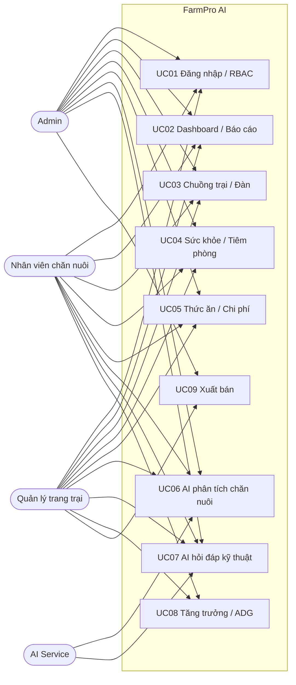
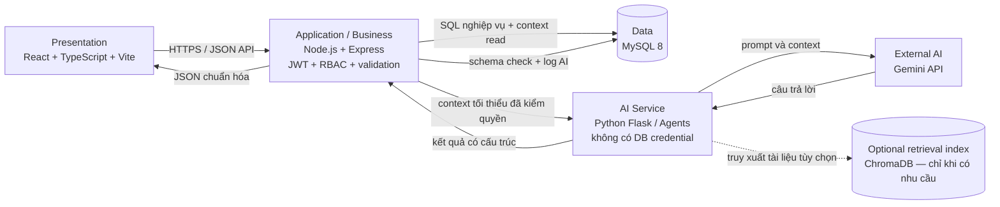

# Bước 2 — Thiết kế hệ thống

## 1. Cơ sở thiết kế và quyết định đã chốt

- Nguồn nghiệp vụ chính: [`AI.pdf`](../tai-lieu-tham-khao/AI.pdf), gồm các tác nhân, UC01–UC09, kiến trúc AI và danh mục bảng đề xuất.
- Yêu cầu đã phân tích: [`phan-tich-yeu-cau-buoc-1.md`](../phan-tich-yeu-cau-buoc-1.md).
- Repo hiện tại: React/Vite, Node/Express, Flask và MySQL trong Docker Compose; repo có 10 bảng ứng dụng hiện tại, trong khi mô hình nguồn và nghiệp vụ cần một mô hình đích khác.
- Người dùng chốt dùng ERD đích theo yêu cầu đã xác nhận, có bảng ánh xạ sang schema hiện tại; chưa sửa schema hoặc migration trong bước này.
- Người dùng chốt luồng AI: Backend xác thực quyền, đọc dữ liệu và tạo context; AI Service chỉ nhận context cần thiết và trả kết quả; Backend kiểm tra/lưu nhật ký. AI Service không truy cập MySQL.
- Phạm vi MVP: bò, heo, gà. Vai trò: Admin, Quản lý trang trại, Nhân viên chăn nuôi; nghiệp vụ Kỹ thuật viên thú y được gộp vào Nhân viên.

## 2. Tác nhân

| Tác nhân | Mục tiêu |
|---|---|
| Admin | Quản trị người dùng/vai trò và giám sát hệ thống; quyền nghiệp vụ theo phạm vi được cấu hình. |
| Quản lý trang trại | Xem tình hình trại, quản lý nghiệp vụ và báo cáo; lập/xác nhận phiếu xuất bán. |
| Nhân viên chăn nuôi | Thực hiện công việc hằng ngày, ghi nhận dữ liệu sức khỏe/tiêm phòng/thức ăn/tăng trưởng và sử dụng các chức năng AI được cấp quyền. |
| Dịch vụ AI | Tác nhân ngoài hệ thống nghiệp vụ; nhận context đã được Backend giới hạn, trả phân tích có cấu trúc; không ghi dữ liệu vận hành. |

PDF có chỗ ghi “4 vai trò” nhưng chỉ liệt kê ba tác nhân chính; UC08 dùng tên “Kỹ thuật viên thú y”. Theo lựa chọn đã chốt, đặc tả này dùng ba vai trò và gộp nghiệp vụ kỹ thuật vào Nhân viên.

## 3. Danh mục Use Case

| Mã | Use Case | Tác nhân chính | Phạm vi |
|---|---|---|---|
| UC01 | Đăng nhập và xác thực phân quyền | Admin, Quản lý, Nhân viên | Xác thực tài khoản, tạo JWT, áp dụng RBAC. |
| UC02 | Xem Dashboard và báo cáo tổng quan | Cả ba vai trò | Tổng hợp đàn, sức khỏe, tiêm phòng, thức ăn, chi phí và cảnh báo theo quyền. |
| UC03 | Quản lý chuồng trại và đàn vật nuôi | Cả ba vai trò | Xem/thêm/sửa/xóa chuồng và vật nuôi theo quyền; kiểm tra dữ liệu trùng/hợp lệ. |
| UC04 | Quản lý sức khỏe và tiêm phòng | Cả ba vai trò | Ghi nhận sức khỏe, triệu chứng, cân nặng/nhiệt độ, lịch sử và lịch tiêm. |
| UC05 | Quản lý thức ăn và chi phí | Cả ba vai trò | Quản lý danh mục, nhập/sử dụng, tồn và chi phí; chặn sử dụng vượt tồn. |
| UC06 | Hỗ trợ chăn nuôi bằng AI | Cả ba vai trò theo quyền dữ liệu | Phân tích context đã được Backend cấp quyền; trả phát hiện, mức rủi ro và khuyến nghị. |
| UC07 | Trợ lý hỏi đáp kỹ thuật AI | Cả ba vai trò theo quyền dữ liệu | Hỏi đáp trong phạm vi chăn nuôi; lưu lịch sử; xử lý câu hỏi ngoài phạm vi/lỗi. |
| UC08 | Theo dõi tăng trưởng đàn | Quản lý, Nhân viên | Lưu kỳ cân mẫu, tính khối lượng trung bình và ADG, cảnh báo dữ liệu bất thường. |
| UC09 | Quản lý xuất bán vật nuôi | Quản lý, Admin | Tạo phiếu, tính doanh thu, cập nhật biến động/quân số trong transaction, xuất PDF. |

UC05 có tiêu đề bị ghi trùng với UC04 trong mục lục PDF; nội dung Use Case xác định đây là quản lý thức ăn và chi phí.

## 4. Đặc tả Use Case

### UC01 — Đăng nhập và xác thực phân quyền

- **Tác nhân:** Admin, Quản lý, Nhân viên.
- **Tiền điều kiện:** Tài khoản đã được cấp và đang hoạt động.
- **Luồng chính:** Người dùng mở màn hình đăng nhập → nhập tên đăng nhập/mật khẩu → client kiểm tra trường bắt buộc → Backend kiểm tra tài khoản và BCrypt hash → Backend phát JWT có role → điều hướng tới màn hình theo quyền.
- **Ngoại lệ:** Thiếu trường thì yêu cầu nhập; thông tin sai trả 401; tài khoản bị khóa/vô hiệu hóa trả 403; mọi API được bảo vệ phải từ chối yêu cầu không có quyền.
- **Hậu điều kiện:** Phiên hợp lệ được tạo; quyền được kiểm tra tại Backend, không chỉ ẩn chức năng ở giao diện.

### UC02 — Dashboard và báo cáo tổng quan

- **Tác nhân:** Cả ba vai trò, với phạm vi dữ liệu theo quyền.
- **Tiền điều kiện:** Đã đăng nhập và có quyền xem dữ liệu/báo cáo.
- **Luồng chính:** Mở Dashboard/báo cáo → Backend truy vấn/tổng hợp đàn, sức khỏe, tiêm phòng, thức ăn, chi phí và dữ liệu AI liên quan → hiển thị chỉ số → người dùng chọn phạm vi báo cáo → hệ thống trả báo cáo theo quyền.
- **Ngoại lệ:** Không có dữ liệu thì hiển thị trạng thái rỗng; thiếu quyền trả từ chối; lỗi truy vấn hiển thị lỗi, không giả dữ liệu thành công.
- **Hậu điều kiện:** Số liệu hiển thị phản ánh dữ liệu thực mà người dùng được phép xem.

### UC03 — Quản lý chuồng trại và đàn

- **Tác nhân:** Cả ba vai trò; thao tác cụ thể được RBAC cho phép.
- **Tiền điều kiện:** Đã đăng nhập; chuồng/loài liên quan tồn tại với thao tác cần thiết.
- **Luồng chính:** Mở danh sách → chọn bản ghi hoặc tạo mới → nhập/cập nhật dữ liệu → Backend kiểm tra bắt buộc, định dạng, trùng mã và quan hệ → lưu → cập nhật danh sách.
- **Ngoại lệ:** Thiếu/sai dữ liệu hoặc trùng thông tin không lưu; đối tượng không tồn tại trả lỗi phù hợp; thao tác trái quyền bị từ chối.
- **Hậu điều kiện:** Bản ghi được lưu nhất quán; không xóa dây chuyền làm mất lịch sử nghiệp vụ.

### UC04 — Sức khỏe và tiêm phòng

- **Tác nhân:** Cả ba vai trò theo quyền xem/cập nhật.
- **Tiền điều kiện:** Đã đăng nhập; đàn/cá thể đích tồn tại.
- **Luồng chính:** Chọn đối tượng → xem lịch sử → nhập dữ liệu sức khỏe/triệu chứng/cân nặng/nhiệt độ hoặc lịch/ghi nhận tiêm → Backend kiểm tra dữ liệu và quyền → lưu lịch sử → hiển thị trạng thái mới.
- **Ngoại lệ:** Dữ liệu không hợp lệ, đối tượng không tồn tại hoặc không có quyền cập nhật thì không ghi dữ liệu.
- **Hậu điều kiện:** Nhật ký sức khỏe và vaccine gắn với đúng đối tượng, người ghi nhận và thời điểm.
- **Ghi chú:** Ngưỡng “sắp đến hạn” và thuộc tính bắt buộc của một mũi tiêm còn cần nhóm xác nhận.

### UC05 — Thức ăn và chi phí

- **Tác nhân:** Cả ba vai trò theo quyền được cấp.
- **Tiền điều kiện:** Đã đăng nhập; thức ăn/đàn liên quan tồn tại.
- **Luồng chính:** Mở danh mục và giao dịch → lập phiếu nhập hoặc sử dụng → nhập lượng, đơn vị, ngày và thông tin giá/chi phí → Backend kiểm tra → lưu giao dịch → tính lại số tồn/chi phí từ giao dịch → hiển thị kết quả.
- **Ngoại lệ:** Lượng không dương, giá không hợp lệ hoặc lượng dùng lớn hơn tồn thì từ chối; không có quyền ghi thì từ chối.
- **Hậu điều kiện:** Số tồn và lịch sử giao dịch nhất quán.
- **Ghi chú:** Tồn kho nên được tính từ sổ giao dịch; không coi một giá trị tồn nhập tay là nguồn sự thật độc lập.

### UC06 — Hỗ trợ chăn nuôi bằng AI

- **Tác nhân:** Người dùng đã xác thực; Backend Orchestrator; AI Service.
- **Tiền điều kiện:** Người dùng có quyền với đối tượng/context cần phân tích; dịch vụ AI khả dụng.
- **Luồng chính:** Người dùng gửi yêu cầu → Backend xác thực và giới hạn phạm vi → Backend đọc dữ liệu cần thiết, loại bỏ dữ liệu không cần thiết và tạo context → gọi AI Service → kiểm tra schema/giới hạn đầu ra → ghi nhật ký yêu cầu/kết quả ở Backend → trả kết quả kèm mức độ tin cậy, giới hạn và disclaimer.
- **Ngoại lệ:** Thiếu context thì hỏi bổ sung hoặc báo chưa đủ cơ sở; context không được phép bị từ chối trước khi gọi AI; dịch vụ timeout/lỗi hoặc kết quả sai schema trả trạng thái lỗi rõ ràng, không giả thành công.
- **Hậu điều kiện:** Có kết quả phân tích được lưu nếu xử lý thành công; không có thay đổi trạng thái nghiệp vụ do AI.
- **Rào chắn:** AI chỉ đề xuất, không trực tiếp INSERT/UPDATE/DELETE nghiệp vụ, không chẩn đoán pháp lý hoặc kê đơn thay chuyên gia.

### UC07 — Trợ lý hỏi đáp kỹ thuật AI

- **Tác nhân:** Người dùng đã xác thực; Backend Orchestrator; AI Service.
- **Tiền điều kiện:** Dịch vụ AI khả dụng; nếu câu hỏi cần dữ liệu trại thì người dùng có quyền xem dữ liệu đó.
- **Luồng chính:** Người dùng nhập câu hỏi → Backend kiểm tra quyền/context → gọi AI → kiểm tra kết quả → trả lời và lưu lịch sử câu hỏi/trả lời.
- **Ngoại lệ:** Câu hỏi mơ hồ thì yêu cầu làm rõ; câu hỏi ngoài phạm vi thì nêu giới hạn; lỗi dịch vụ thì thông báo; không cung cấp context trái quyền.
- **Hậu điều kiện:** Lịch sử được lưu theo chính sách lưu trữ cần nhóm chốt.

### UC08 — Theo dõi tăng trưởng đàn

- **Tác nhân:** Quản lý, Nhân viên (bao gồm nghiệp vụ Kỹ thuật viên đã gộp).
- **Tiền điều kiện:** Đã đăng nhập; đàn đang trong chu kỳ nuôi.
- **Luồng chính:** Chọn đàn → tạo kỳ cân → nhập ngày, số con mẫu và tổng khối lượng mẫu → Backend kiểm tra số liệu dương và ngày không trước ngày bắt đầu nuôi → tính khối lượng trung bình và ADG từ kỳ trước → lưu → cập nhật biểu đồ/lịch sử.
- **Ngoại lệ:** Số liệu không dương hoặc ngày không hợp lệ thì từ chối; ADG > 1.500 g/ngày hoặc sụt cân được đánh dấu cảnh báo để xác nhận dữ liệu.
- **Hậu điều kiện:** Kỳ cân được lưu; chỉ số được tính từ số đo. Mốc 1.500 g/ngày lấy nguyên từ PDF, cần xác nhận có áp dụng chung cho cả ba loài hay không.

### UC09 — Xuất bán vật nuôi

- **Tác nhân:** Quản lý hoặc Admin.
- **Tiền điều kiện:** Đã đăng nhập; đàn còn số lượng dương; người dùng có quyền xuất bán.
- **Luồng chính:** Chọn đàn → nhập ngày, số lượng, tổng khối lượng lô, đơn giá và đối tác → Backend xác thực đầu vào và quyền → xác nhận số lượng không vượt quân số → tính doanh thu → bắt đầu DB transaction → ghi phiếu và biến động đàn, giảm số lượng → đóng đàn nếu còn 0 → commit → trả mã phiếu và cho phép xuất PDF.
- **Ngoại lệ:** Số lượng vượt quân số, số lượng/khối lượng/đơn giá không dương thì từ chối; lỗi bất kỳ trong transaction thì rollback toàn bộ.
- **Hậu điều kiện:** Phiếu, doanh thu suy ra, biến động và quân số nhất quán; có chứng từ PDF.
- **Ghi chú:** Quy định khóa xuất bán cá thể đang điều trị/cách ly xuất hiện ở tài liệu nội bộ khác, không nằm trong Use Case UC09 của PDF nguồn. Chưa bổ sung thành tiêu chí chặn cho đến khi nhóm xác nhận nguồn nghiệp vụ đó là chuẩn.

## 5. Sơ đồ Use Case

Sơ đồ thể hiện các Use Case mà tác nhân được nêu trong nguồn. Quyền chi tiết theo thao tác và phạm vi dữ liệu vẫn phải được cấu hình/kiểm chứng tại Backend; sơ đồ không cấp quyền vượt qua RBAC.

## 6. ERD đích đề xuất theo 3NF

ERD này là mô hình thiết kế đích, không phải mô tả schema hiện tại và chưa phải migration đã chạy. Tách danh mục/quan hệ, giữ sự kiện ở các bảng giao dịch và tính các số tổng hợp từ dữ liệu nguồn giúp giảm trùng lặp.

```mermaid
erDiagram
    ROLES ||--o{ USERS : assigns
    USERS ||--o{ HERD_MOVEMENTS : records
    USERS ||--o{ HEALTH_RECORDS : records
    USERS ||--o{ VACCINATIONS : records
    USERS ||--o{ FEED_TRANSACTIONS : records
    USERS ||--o{ EXPENSES : records
    USERS ||--o{ SALES : records
    USERS ||--o{ AI_REQUESTS : submits

    SPECIES ||--o{ BARNS : intended_for
    BARNS ||--o{ HERDS : houses
    HERDS ||--o{ HERD_MOVEMENTS : changes
    HERDS ||--o{ HEALTH_RECORDS : has
    SYMPTOMS ||--o{ HEALTH_RECORDS : categorizes
    HERDS ||--o{ VACCINATIONS : receives
    VACCINES ||--o{ VACCINATIONS : identifies
    HERDS ||--o{ GROWTH_RECORDS : measured_by
    FEED_TYPES ||--o{ FEED_TRANSACTIONS : transacted
    HERDS o|--o{ FEED_TRANSACTIONS : consumes
    BARNS o|--o{ EXPENSES : incurs
    HERDS o|--o{ CARE_TASKS : targets
    BARNS o|--o{ CARE_TASKS : targets
    USERS o|--o{ CARE_TASKS : assigned
    HERDS ||--o{ SALES : sold_from
    HERDS o|--o{ AI_REQUESTS : context_for
    BARNS o|--o{ AI_REQUESTS : context_for
    AI_REQUESTS ||--o| AI_ANALYSIS_RESULTS : returns
    AI_ANALYSIS_RESULTS ||--o{ AI_RESULT_DETAILS : contains

    ROLES {
        int id PK
        varchar name UK
        varchar description
    }
    USERS {
        int id PK
        varchar username UK
        varchar email UK
        varchar password_hash
        int role_id FK
        varchar status
    }
    SPECIES {
        int id PK
        varchar name UK
        varchar status
    }
    BARNS {
        int id PK
        varchar code UK
        varchar name
        int species_id FK
        int capacity
        varchar status
    }
    HERDS {
        int id PK
        varchar code UK
        int barn_id FK
        int initial_count
        date start_date
        varchar status
    }
    HERD_MOVEMENTS {
        int id PK
        int herd_id FK
        int user_id FK
        varchar movement_type
        int quantity
        date movement_date
        varchar reason
    }
    SYMPTOMS {
        int id PK
        varchar name UK
        varchar description
    }
    HEALTH_RECORDS {
        int id PK
        int herd_id FK
        int user_id FK
        int symptom_id FK
        date checked_at
        decimal weight_kg
        decimal temperature_c
        varchar assessment
        text action_taken
    }
    VACCINES {
        int id PK
        varchar name
        varchar manufacturer
    }
    VACCINATIONS {
        int id PK
        int herd_id FK
        int vaccine_id FK
        int user_id FK
        date due_date
        date administered_at
        varchar status
        varchar dosage
    }
    FEED_TYPES {
        int id PK
        varchar name UK
        varchar category
        varchar unit
        decimal unit_price
    }
    FEED_TRANSACTIONS {
        int id PK
        int feed_type_id FK
        int herd_id FK
        int user_id FK
        varchar transaction_type
        decimal quantity
        decimal unit_price
        date transaction_date
    }
    EXPENSES {
        int id PK
        int user_id FK
        int barn_id FK
        varchar category
        decimal amount
        date spent_at
    }
    CARE_TASKS {
        int id PK
        int herd_id FK
        int barn_id FK
        int assigned_user_id FK
        varchar title
        date due_date
        varchar priority
        varchar status
    }
    GROWTH_RECORDS {
        int id PK
        int herd_id FK
        date measured_at
        int sample_count
        decimal sample_total_weight_kg
    }
    SALES {
        int id PK
        int herd_id FK
        int user_id FK
        date sold_at
        int quantity
        decimal total_weight_kg
        decimal price_per_kg
        varchar buyer
    }
    AI_REQUESTS {
        int id PK
        int user_id FK
        int herd_id FK
        int barn_id FK
        varchar model_name
        varchar model_version
        varchar request_type
        text request_text
        text sanitized_context
        varchar status
        datetime created_at
    }
    AI_ANALYSIS_RESULTS {
        int id PK
        int ai_request_id FK
        varchar summary
        text findings
        decimal confidence
        datetime created_at
    }
    AI_RESULT_DETAILS {
        int id PK
        int result_id FK
        varchar detail_type
        varchar title
        text content
        varchar severity
        decimal risk_score
    }
```

### Ràng buộc và thuộc tính suy ra

- PK trên mỗi bảng; FK cho các quan hệ thể hiện trong ERD; `UNIQUE` cho tên đăng nhập, email, mã đàn, mã chuồng, danh mục và định danh vaccine phù hợp.
- `CHECK`: số lượng, số tiền, khối lượng và số mẫu hợp lệ theo loại giao dịch; sức chứa không âm; độ tin cậy nằm trong 0–100. Quy tắc liên bảng (sức chứa hiện dùng, lượng sử dụng không vượt tồn, số lượng xuất không vượt đàn) phải được bảo vệ trong transaction/service; không dựa riêng vào `CHECK`.
- Số lượng đàn hiện tại = số lượng ban đầu + tổng biến động nhập − xuất − hao hụt; tồn kho = tổng giao dịch nhập − tổng giao dịch sử dụng. Nên truy vấn qua view/service để tránh hai nguồn sự thật.
- Khối lượng trung bình mẫu = tổng khối lượng mẫu / số con mẫu; ADG tính từ hai kỳ cân liên tiếp. Doanh thu = khối lượng lô × đơn giá/kg. Đây là số liệu có thể suy ra; không lưu bản sao không cần thiết.
- Loài của đàn được xác định qua chuồng mà đàn đang ở; không lưu lặp `species_id` trên cả đàn và chuồng. Nếu nghiệp vụ cho phép một đàn di chuyển giữa chuồng khác loài, cần điều chỉnh mô hình sau khi nhóm chốt.
- Chi phí từ thức ăn được tính từ `FEED_TRANSACTIONS`; `EXPENSES` dùng cho khoản chi khác để tránh cộng trùng cùng một khoản.
- Công việc có thể gắn đàn, chuồng hoặc cả hai; bản ghi phải chỉ rõ ít nhất một đối tượng đích.
- FK lịch sử nên dùng `RESTRICT`/soft-delete cho dữ liệu nghiệp vụ; không xóa dây chuyền đàn, phiếu hoặc nhật ký.
- Schema được hiện thực cần xác nhận phiên bản MySQL để kiểm tra `CHECK`, kiểu JSON và quy tắc transaction.

### Ánh xạ sơ bộ từ schema hiện có

Schema hiện tại có 10 bảng: `users`, `farm_products`, `barns`, `animals`, `weight_records`, `health_logs`, `inventory_items`, `care_tasks`, `sales_records`, `alerts`.

| Bảng hiện tại | Đích đề xuất | Ghi chú chuyển đổi |
|---|---|---|
| `users` | `users` + `roles` | Chuyển role enum sang FK; phải ánh xạ “Chủ trang trại/Kỹ sư/Bác sĩ/Nhân viên” sang ba vai trò đã chốt bằng danh sách tài khoản được duyệt, không thay tên tự động. |
| `farm_products` | `FEED_TYPES` và/hoặc `VACCINES` | Tách theo category; không gộp thuốc, vật tư và vaccine vào danh mục thức ăn. Dữ liệu cần rà soát trước khi migrate. |
| `barns` | `BARNS` + `SPECIES` | Chuẩn hóa loài; số đang nuôi nên suy ra từ đàn thay vì lưu trùng nếu có thể. |
| `animals` | `HERDS` hoặc mô hình cá thể riêng | Bảng hiện tại là cá thể (tag, giới tính, ngày sinh); bảng đích PDF là đàn/lứa. Cần nghiệp vụ chọn mức quản lý cá thể/đàn trước khi biến đổi; không thể migrate 1:1 an toàn. |
| `weight_records` | `GROWTH_RECORDS` | Cần xác định cách nhóm cân từng cá thể thành mẫu đàn; không gộp mất lịch sử/cá thể nếu còn cần theo dõi cá thể. |
| `health_logs` | `HEALTH_RECORDS` + `SYMPTOMS` | Triệu chứng tự do có thể cần chuẩn hóa/đối chiếu; kết quả AI không được chuyển thành chẩn đoán đã xác nhận. |
| `inventory_items` | `FEED_TYPES`/`VACCINES` và giao dịch nhập kho | `quantity` hiện lưu trực tiếp; mô hình đích tính tồn từ sổ giao dịch. Cần tạo số dư mở đầu có xác nhận. |
| `care_tasks` | `CARE_TASKS` và có thể `VACCINATIONS` | Lịch công việc không đồng nghĩa với mũi tiêm đã thực hiện; giữ liên kết/nghiệp vụ riêng. |
| `sales_records` | `SALES` + `HERD_MOVEMENTS` | Hiện ghi bán theo cá thể, đích theo đàn/lô. Cần thiết kế chuyển đổi nghiệp vụ, giữ mã và lịch sử giao dịch. |
| `alerts` | Chưa ánh xạ trực tiếp | Cảnh báo hiện tại không đồng nghĩa với kết quả AI. Quyết định giữ, chuyển thành sự kiện cảnh báo, hay suy ra từ nghiệp vụ sẽ được chốt khi triển khai. |

## 7. Kiến trúc đa tầng và luồng dữ liệu AI

**Quy tắc:** trình duyệt không gọi trực tiếp Gemini/MySQL; Backend là ranh giới xác thực, RBAC, context building, validation kết quả và ghi log. AI Service chỉ nhận context tối thiểu, không có quyền ghi dữ liệu trang trại. ChromaDB/RAG không bắt buộc trong MVP; nếu triển khai thì chỉ phục vụ truy xuất tri thức, tách khỏi CSDL giao dịch.

### Triển khai Compose

| Dịch vụ | Vai trò | Quan hệ khởi động |
|---|---|---|
| `mysql_db` | MySQL 8, schema/volume bền vững, healthcheck | Khởi động đầu tiên |
| `multi_agent_backend` | Flask AI Service, không mount DB credential | Chỉ khởi động sau khi Backend/API sẵn sàng theo healthcheck |
| `web_app` | Node API và frontend build/serve | Chờ DB healthy; gọi AI Service qua mạng nội bộ |
| Gemini | Dịch vụ ngoài Compose | Khóa chỉ được cấu hình ở phía server cần gọi; không đưa vào bundle frontend hoặc log |

Đây là thiết kế đích. Compose hiện có đang dùng root credential và cấp DB credential cho Flask; cần sửa ở bước hạ tầng/bảo mật, không thay đổi trong tài liệu thiết kế này. Thứ tự dependency thực tế nên là MySQL → Backend và AI Service → API healthcheck; không dùng `depends_on` đơn thuần thay cho kiểm tra health.

## 8. Vị trí và giới hạn AI

1. Người dùng gọi tính năng AI qua Backend đã xác thực.
2. Backend áp dụng quyền và truy xuất chỉ phần dữ liệu cần cho yêu cầu.
3. Backend dựng context có nguồn, loại bỏ dữ liệu không cần thiết/nhạy cảm.
4. AI Service suy luận qua Gemini, không có quyền gọi API ghi nghiệp vụ hay kết nối DB.
5. Backend kiểm tra JSON/schema, trường bắt buộc, độ dài và trạng thái; kết quả hợp lệ mới được lưu vào nhật ký AI và trả về.
6. Giao diện nêu rõ nội dung là tham khảo và cần cán bộ thú y xác nhận trước can thiệp.
7. Không đủ dữ liệu/lỗi dịch vụ/đầu ra không hợp lệ phải hiện thông báo lỗi hoặc trạng thái chưa đủ cơ sở; không trả kết quả giả. Hành vi fallback cụ thể cần được xác nhận và kiểm thử ở bước AI.

Disclaimer theo yêu cầu nguồn: **“Khuyến nghị mang tính chất tham khảo dựa trên số liệu lịch sử, người nuôi cần tham vấn cán bộ thú y trước khi can thiệp y tế.”**

## 9. So sánh AI tích hợp và Rule-based

| Tiêu chí | Rule-based | AI/LLM có kiểm soát |
|---|---|---|
| Điều kiện rõ ràng, bất biến | Dễ tái lập và phù hợp để chặn quy tắc cứng như lượng xuất vượt đàn hoặc tồn kho âm. | Không nên quyết định trực tiếp quy tắc giao dịch; kết quả cần được kiểm tra. |
| Dữ liệu nhiều chiều, mô tả ngôn ngữ tự nhiên | Cần liệt kê nhánh và mẫu trước; khó tổng hợp nội dung tự do. | Có thể tóm tắt context và diễn giải dấu hiệu kết hợp, nhưng có nguy cơ suy diễn/ảo giác. |
| Tính lặp lại | Kết quả xác định khi cùng dữ liệu và luật. | Có thể thay đổi theo prompt/model; cần ghi phiên bản và đo prompt. |
| Giải thích | Giải thích bằng điều kiện luật đã kích hoạt. | Có thể tạo lời giải thích tự nhiên; lời giải thích không phải bằng chứng sự thật. |
| Mở rộng | Mỗi quy tắc mới cần bổ sung/kiểm tra logic. | Có thể điều chỉnh context/prompt; vẫn cần kiểm thử an toàn và phạm vi. |
| Vai trò trong hệ thống | Nguồn quyết định cho validation/ràng buộc cứng và fallback xác định. | Công cụ hỗ trợ tóm tắt, cảnh báo/khuyến nghị; human-in-the-loop, không ghi dữ liệu nghiệp vụ. |

## 10. Các quyết định còn cần xác nhận trước triển khai

- Mức quản lý dữ liệu là cá thể, đàn/lứa hay kết hợp theo loài; PDF và schema hiện tại chưa nhất quán.
- Ma trận quyền chính xác của Admin/Quản lý/Nhân viên ngoài quyền xuất bán đã nêu rõ.
- Có áp dụng quy tắc thời gian ngưng thuốc trước bán từ tài liệu nội bộ khác hay không; chưa có trong UC09 nguồn đang dùng.
- Mốc cảnh báo ADG 1.500 g/ngày có dùng chung cho bò/heo/gà không; định nghĩa “sụt cân nghiêm trọng”.
- Công thức/đầu vào FCR, ngưỡng cảnh báo chăm sóc-tiêm, chính sách lưu context AI và timeout/fallback.
- Cách xử lý dữ liệu đang có trong `animals`, `weight_records`, `sales_records`, dữ liệu seed và tên vai trò cũ khi migrate.

## 11. Bàn giao và tự kiểm tra

- **Bàn giao:** Use Case UC01–UC09, sơ đồ Use Case, ERD đích 3NF đề xuất, ánh xạ bảng hiện có, kiến trúc đa tầng/Compose, vị trí AI và so sánh Rule-based.
- **Cách kiểm tra:** xem các sơ đồ Mermaid trong file; đối chiếu UC với phần 3.3 PDF, kiến trúc với phần 1.5–1.6 và các thực thể với phần 6.2–6.3.
- **Kết quả tự kiểm tra:** giữ rõ ranh giới giữa mô hình đích và 10 bảng hiện có; không chạy/migrate schema; các điểm không nhất quán và quyết định chưa được xác nhận được liệt kê thay vì âm thầm đổi code.
- **Đối chiếu tiêu chí:** T1 — Use Case/ERD/kiến trúc; T2 — đặt vị trí và luồng tích hợp AI; T3 — RBAC, validation, an toàn, lỗi AI; T4 — Compose và trách nhiệm dịch vụ; T5 — human-in-the-loop, ranh giới AI và kiểm chứng.
